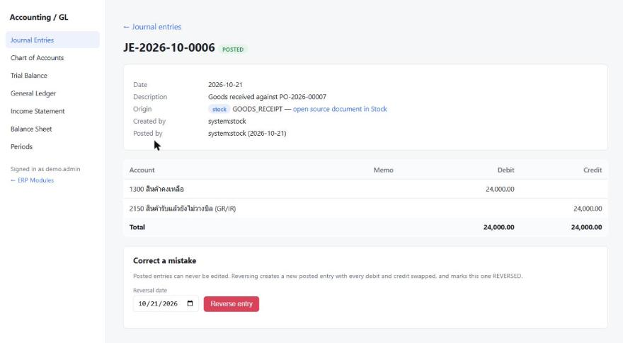
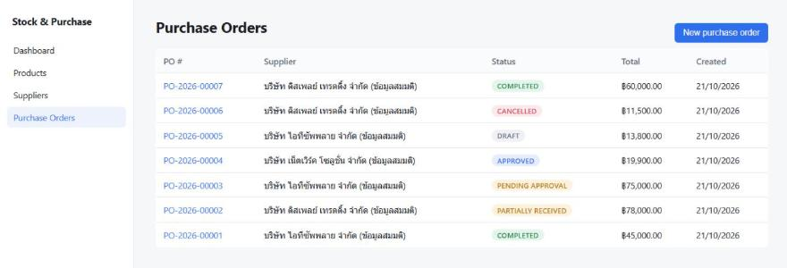
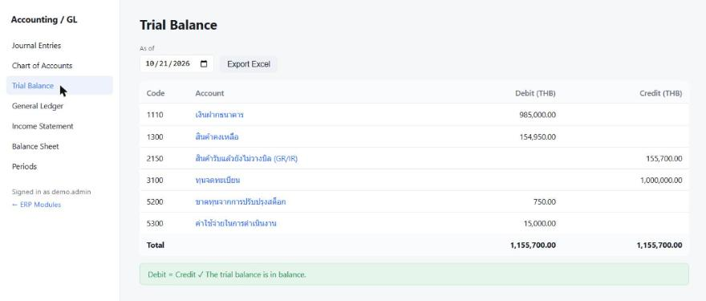
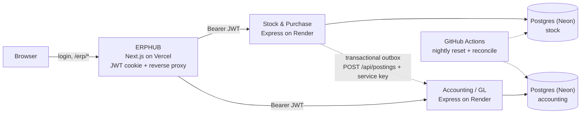

# K-ERP — a modular ERP: Stock & Purchasing + Double-entry General Ledger

**[Live demo](https://k-erp-hub.vercel.app)** · [Source repositories](#modules) · [How I built this](#how-i-built-this) · [Deployment report](#tests--results)

[](https://github.com/kingly5556/K-ERP/actions/workflows/reset-demo.yml)



## What it is

K-ERP is a small business system for buying and stocking goods. Staff raise purchase orders,
a manager approves the big ones, the warehouse receives the goods, and **the accounting entry
appears in the general ledger on its own**, exactly once, even if the accounting service was down
at the time.

## Try it

Open **https://k-erp-hub.vercel.app** and press one of the role buttons on the login page.
No sign-up needed; the demo data is reset every night at 03:00 (Bangkok time).

| Role | What to try |
|---|---|
| Purchasing | Create a purchase order and submit it |
| Manager | Approve purchase orders over 50,000 THB |
| Warehouse | Receive goods (partial or full), adjust stock |
| Accountant | Journal entries, trial balance, income statement, balance sheet |
| Admin | Everything, plus period close |

> Free hosting: a module that has been idle sleeps. The first page after a quiet spell can take
> about **30 seconds** to wake up (measured on production); after that it is fast.

## Modules

| Module | What it does | Stack | Repositories |
|---|---|---|---|
| **ERPHUB** | Single sign-on and gateway: one login, then every module is reached under the same domain | Next.js 16 (reverse proxy, JWT in an httpOnly cookie) | [K-ERPHub](https://github.com/kingly5556/K-ERPHub) |
| **Stock & Purchase** | Products, suppliers, purchase orders with approval, goods receipts, stock ledger | Express · Prisma · PostgreSQL · React + Vite | [Backend](https://github.com/kingly5556/Stock-Purchase-Backend) · [Frontend](https://github.com/kingly5556/Stock-Purchase-Frontend) |
| **Accounting / GL** | Double-entry journal, chart of accounts, periods and year-end close, financial statements | Express · Prisma · PostgreSQL · React + Vite | [Backend](https://github.com/kingly5556/Accounting-Backend) · [Frontend](https://github.com/kingly5556/Accounting-Frontend) |

| Purchase orders | Trial balance |
|---|---|
|  |  |

## Architecture



Each module owns its own database. The only link between them is the outbox: a goods receipt
and the message "post this to accounting" are written in **one database transaction**, and a
worker delivers the message with retries and backoff.

## Engineering highlights

- **No lost or duplicated postings.** Transactional outbox in Stock ([`src/shared/outbox`](https://github.com/kingly5556/Stock-Purchase-Backend/tree/main/src/shared/outbox)) plus an idempotency key `(sourceModule, sourceType, sourceId)` in Accounting. Verified on production by suspending Accounting, receiving goods, and resuming: the entry was posted once, on the 6th retry.
- **Stock never goes negative under concurrency.** Every stock movement locks the product row (`SELECT … FOR UPDATE`) before writing to an append-only ledger ([`inventory.service.ts`](https://github.com/kingly5556/Stock-Purchase-Backend/blob/main/src/modules/inventory/inventory.service.ts)).
- **Accounting rules enforced twice.** In the application and in PostgreSQL itself: a `CHECK` that a line is debit *or* credit, and triggers that refuse any change to a posted entry, even from raw SQL ([migration](https://github.com/kingly5556/Accounting-Backend/blob/main/prisma/migrations/20261010084125_init/migration.sql)).
- **Money as integers.** All amounts are `BigInt` satang (1/100 baht), never floats; JSON carries them as strings.
- **Gap-free document numbers under load.** PO numbers come from a counter row updated with `INSERT … ON CONFLICT DO UPDATE … RETURNING` inside the same transaction; a test fires 20 concurrent creates and gets 1–20 with no duplicates.
- **Stock value reconciles with the ledger every night.** The reset job compares inventory value in Stock with GL account 1300 and fails loudly if they differ ([`scripts/reconcile.mjs`](scripts/reconcile.mjs)).

## Tests & results

| What | Result | When |
|---|---|---|
| Accounting unit + integration tests (real PostgreSQL) | 101 / 101 pass | 15 Oct 2026 |
| Stock unit + integration tests (incl. concurrent PO numbering) | 28 / 28 pass | 15 Oct 2026 |
| End-to-end across modules (outbox, outage + recovery, retries, reconciliation) | 23 / 23 pass | 15 Oct 2026 |
| Role permissions through the hub (16 actions × 5 roles) | 80 / 80 as designed | 15 Oct 2026 |
| Production smoke flow: PO 60,000 → approve → receive twice → two journal entries | pass, trial balance balanced | 21 Oct 2026 |
| Production outage test: Accounting suspended during a goods receipt | posted once after resume | 21 Oct 2026 |
| Nightly reset + reconciliation (stock value = GL 1300 = 91,050.00 THB) | pass | every night |

Bugs that only showed up in production (and their fixes) are written up in the deployment
report: a stale build cache on Render, a Prisma transaction timeout when seeding across regions,
and Render's own "waking up" page leaking through the proxy.

## Run locally

Each service has its own README with details. In short (Node 22, Docker):

```bash
# one Postgres for both modules (each module uses its own database in it)
docker run -d --name k-erp-stock-pg -e POSTGRES_PASSWORD=postgres -p 5433:5432 postgres:16-alpine

# each backend (Stock on :4001, Accounting on :4002) — see its README for the frontend build
cp .env.example .env && npm install && npx prisma migrate dev && npm run prisma:seed && npm run dev

# K-ERPHub (:3000)
cp .env.local.example .env.local && npm install && npm run dev
```

The same `JWT_SECRET` must be set in the hub and both backends, and the same
`ACCOUNTING_SERVICE_KEY` in both backends.

## How I built this

I designed the architecture, the data model and the business rules, and wrote them down as specs
(`AGENTS.md`) before any code. I used AI coding assistants to generate much of the implementation,
then reviewed it, ran and extended the tests, and fixed what was wrong. The trade-offs are recorded
in the technical report and in each repository's docs. I can walk through any part of the code and
explain why it is built that way.

## Known limitations & what I would do next

- Free hosting: modules sleep when idle (≈30 s first load) and share a monthly hours quota.
- The UI does not hide buttons by role; the backend is the authority and answers 403.
- Single instance per module; scaling out would need `SKIP LOCKED` in the outbox worker.
- Next: VAT on purchases, vendor invoices (clearing GR/IR 2150), and a demo video.

## Repository contents

| Path | What it is |
|---|---|
| `.github/workflows/reset-demo.yml` | Nightly reset of the public demo: reset + seed both databases, wake both services, drain the outbox, reconcile |
| `scripts/reconcile.mjs` | Checks that the stock value in Stock equals GL account 1300 in Accounting |
| `render.yaml` | Render Blueprint for the two backend services |
| `docs/images/` | Screenshots used in the READMEs |

## About me

Kongkat Thanalertrungroj — new-grad developer looking for a Junior Backend / Full-stack role.
Portfolio: [king-profile.vercel.app](https://king-profile.vercel.app) · GitHub: [@kingly5556](https://github.com/kingly5556)
